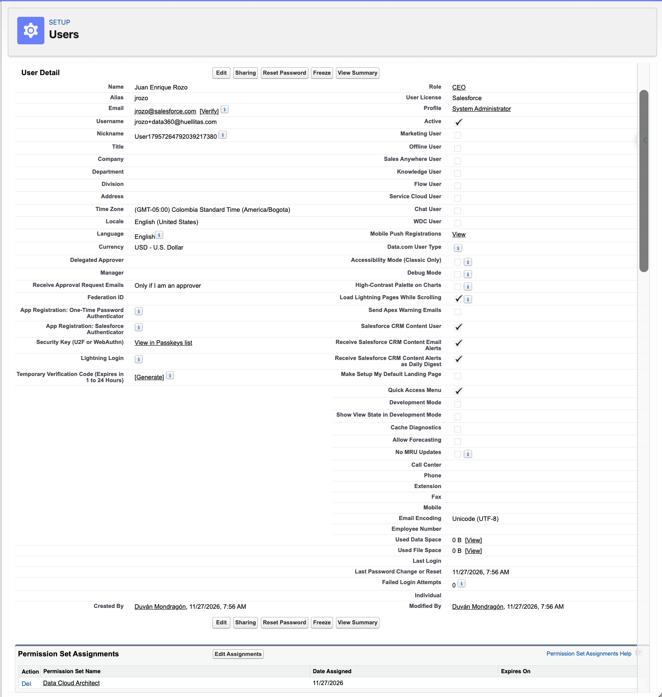
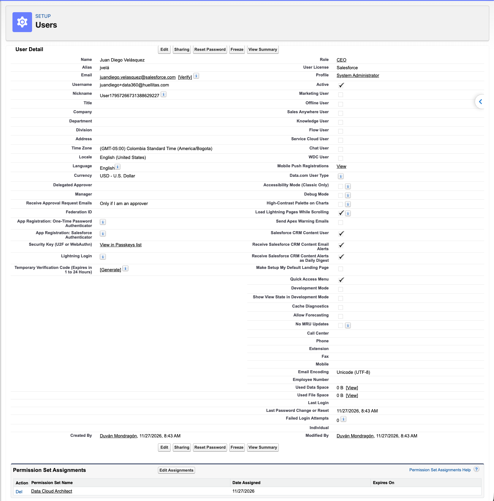

# Paso manual RB-F4-01: Usuarios de Juan Diego y Juan Enrique con permisos de Data Cloud Architect

Paso a paso para la creación manual de los usuarios y asignación de conjunto de permisos.

## Id

RB-F4-01

## HU

f4-s1, f4-s2, f4-s3, f4-s4

## ¿Por qué no viaja por metadata?

> El motivo y el enlace a la documentación que lo dice. Si no lo encuentran, escriban «por confirmar» y lo revisan con Edgar antes de hacer nada a mano.

[motivo] · [enlace a la documentación oficial]

## Prerrequisitos

Cupos disponibles de User License `Salesforce` en `Setup → Company Information`.

## Org destino

SDO F4

## Quién lo ejecuta

- Joan Emmanuel Orduz
- Duván Felipe Mondragón

## Pasos exactos

1. Setup > Company Settings > Company Information > User Licenses > Salesforce > Remaining Licenses = confirmar 2 o más libres
2. Setup > Company Settings > Company Information > Permission Set Licenses > Data Cloud > Remaining Licenses = confirmar 2 o más libres
3. Setup > Users > Users > New User > First Name = Juan Enrique
4. Setup > Users > Users > New User > Last Name = Rozo
5. Setup > Users > Users > New User > Alias = jrozo
6. Setup > Users > Users > New User > Email = [jrozo@salesforce.com](mailto:jrozo@salesforce.com)
7. Setup > Users > Users > New User > Username = [jrozo+data360@huellitas.com](mailto:jrozo.data360@huellitas.com)
8. Setup > Users > Users > New User > Role = CEO
9. Setup > Users > Users > New User > User License = Salesforce
10. Setup > Users > Users > New User > Profile = System Administrator
11. Setup > Users > Users > New User > Active = Checked (True)
12. Setup > Users > Users > New User > Time Zone = (GMT-05:00) Colombia Standard Time (America/Bogota)
13. Setup > Users > Users > New User > Generate new password and notify user immediately = Checked (True)
14. Setup > Users > Users > New User > Save = Clic en Save
15. Setup > Users > Users > [Juan Enrique Rozo] > Permission Set Assignments > Edit Assignments > Available Permission Sets = Seleccionar Data Cloud Architect y clic en Add
16. Setup > Users > Users > [Juan Enrique Rozo] > Permission Set Assignments > Edit Assignments > Enabled Permission Sets = Data Cloud Architect
17. Setup > Users > Users > [Juan Enrique Rozo] > Permission Set Assignments > Edit Assignments > Save = Clic en Save
18. Setup > Users > Users > New User > First Name = Juan Diego
19. Setup > Users > Users > New User > Last Name = Velásquez
20. Setup > Users > Users > New User > Alias = jdiego
21. Setup > Users > Users > New User > Email = juandiego.velasquez@gmail.com
22. Setup > Users > Users > New User > Username = [jdiego+data360@huellitas.com](mailto:jdiego.data360@huellitas.com)
23. Setup > Users > Users > New User > Role = CEO
24. Setup > Users > Users > New User > User License = Salesforce
25. Setup > Users > Users > New User > Profile = System Administrator
26. Setup > Users > Users > New User > Active = Checked (True)
27. Setup > Users > Users > New User > Time Zone = (GMT-05:00) Colombia Standard Time (America/Bogota)
28. Setup > Users > Users > New User > Generate new password and notify user immediately = Checked (True)
29. Setup > Users > Users > New User > Save = Clic en Save
30. Setup > Users > Users > [Juan Diego] > Permission Set Assignments > Edit Assignments > Available Permission Sets = Seleccionar Data Cloud Architect y clic en Add
31. Setup > Users > Users > [Juan Diego] > Permission Set Assignments > Edit Assignments > Enabled Permission Sets = Data Cloud Architect
32. Setup > Users > Users > [Juan Diego] > Permission Set Assignments > Edit Assignments > Save = Clic en Save

## Resultado esperado y evidencia

Quedan dos usuarios activos en Setup > Users. Cada uno tiene licencia Salesforce, perfil System Administrator, rol CEO, zona horaria (GMT-05:00) Colombia Standard Time (America/Bogota) y el permission set Data Cloud Architect en Permission Set Assignments.

**Juan Enrique Rozo.** Username `jrozo+data360@huellitas.com`, alias `jrozo`, activo. Data Cloud Architect asignado el 11/27/2026.

**Juan Diego Velásquez.** Username `juandiego+data360@huellitas.com`, alias `jvelá`, activo. Data Cloud Architect asignado el 11/27/2026.

## Cómo se verifica

Revisa Duván Mondragón con el usuario [duvan+f4@huellitas.com](mailto:duvan+f4@huellitas.com).

## Cómo se deshace

Nota de reversibilidad: La creación física del registro User y el envío del correo de notificación no se pueden deshacer, Salesforce no permite eliminar registros de usuario por trazabilidad y auditoría. Para revertir funcionalmente el acceso, liberar los cupos de licencia y liberar los Usernames, ejecutar:

1. Setup > Users > Users > [Juan Enrique Rozo] > Permission Set Assignments > Data Cloud Architect > Action = Clic en Del (y clic en OK en la confirmación)

2. Setup > Users > Users > [Juan Enrique Rozo] > Permission Set License Assignments > Data Cloud > Action = Clic en Del (si sigue listada tras el paso 1)

3. Setup > Users > Users > [Juan Enrique Rozo] > Edit > Active = Unchecked (False) (y clic en OK en la alerta de desactivación)

4. Setup > Users > Users > [Juan Enrique Rozo] > Edit > Username = [jrozo+data360.inactivo@huellitas.com](mailto:jrozo+data360.inactivo@huellitas.com) (libera el Username original por si se requiere volver a crear)

5. Setup > Users > Users > [Juan Enrique Rozo] > Edit > Save = Clic en Save

6. Setup > Users > Users > [Juan Diego Velásquez] > Permission Set Assignments > Data Cloud Architect > Action = Clic en Del (y clic en OK en la confirmación)

7. Setup > Users > Users > [Juan Diego Velásquez] > Permission Set License Assignments > Data Cloud > Action = Clic en Del (si sigue listada tras el paso 6)

8. Setup > Users > Users > [Juan Diego Velásquez] > Edit > Active = Unchecked (False) (y clic en OK en la alerta de desactivación)

9. Setup > Users > Users > [Juan Diego Velásquez] > Edit > Username = [jdiego+data360.inactivo@huellitas.com](mailto:jdiego+data360.inactivo@huellitas.com) (libera el Username original por si se requiere volver a crear)

10. Setup > Users > Users > [Juan Diego Velásquez] > Edit > Save = Clic en Save

11. Setup > Company Settings > Company Information > User Licenses > Salesforce > Remaining Licenses = confirmar que se recuperaron las 2 licencias libres

12. Setup > Company Settings > Company Information > Permission Set Licenses > Data Cloud > Remaining Licenses = confirmar que se recuperaron las 2 licencias libres

## Estado y fecha

- [x] Ejecutado: 2026-11-26, Duván Mondragón
